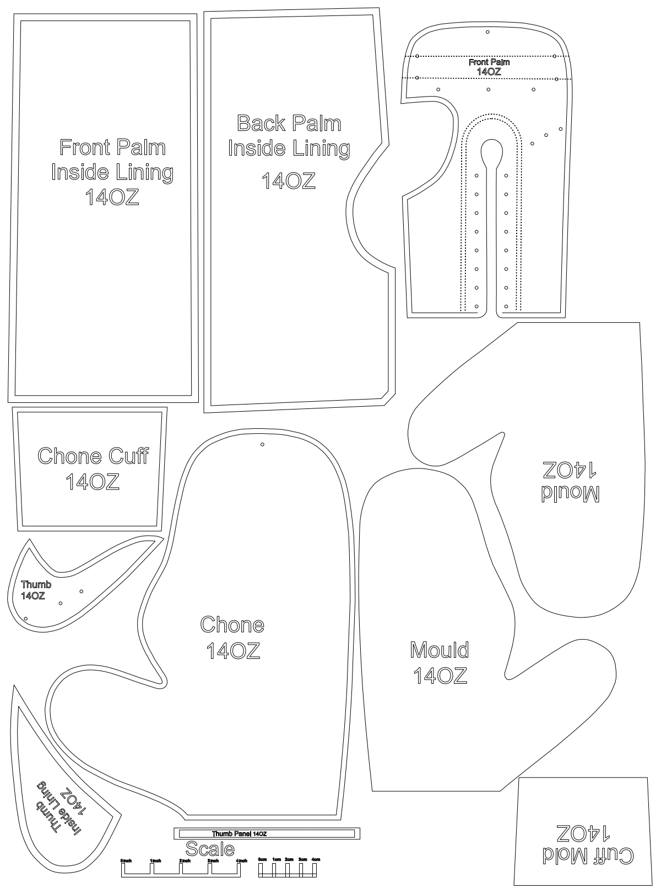
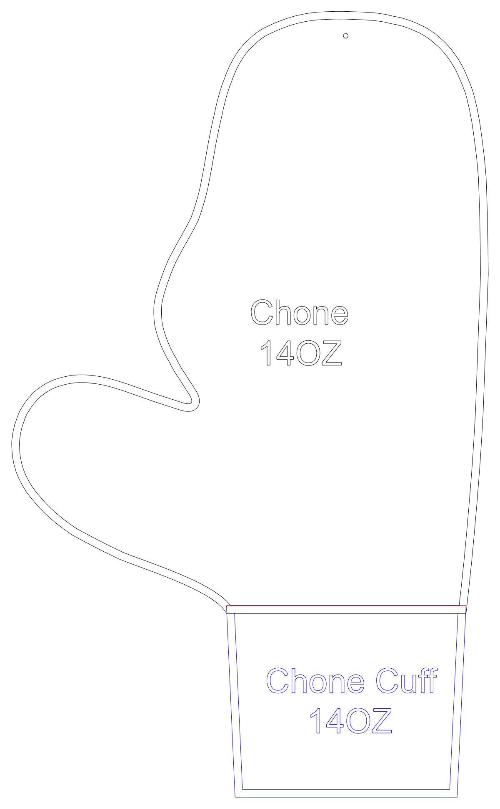
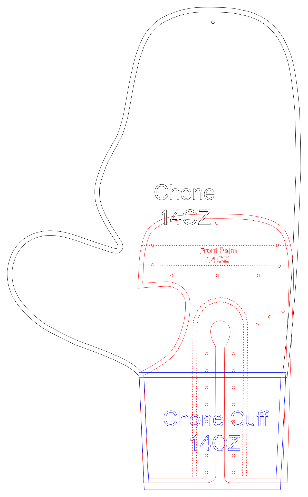
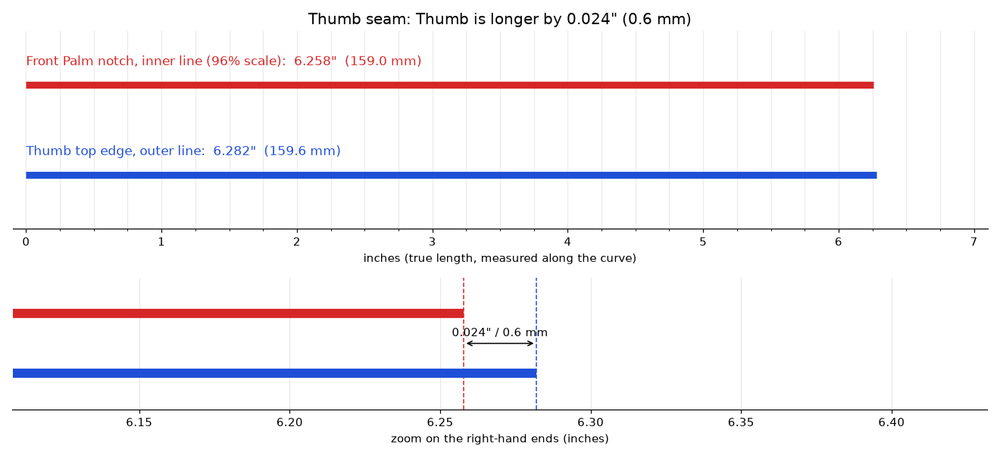
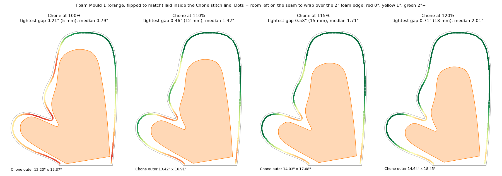

# Laces Boxing 14OZ: pattern analysis and palm rescale

2026-11-13

## Summary

The Front Palm in the 14 oz lace-up glove pattern was drawn about 4% too big for the pieces it is sewn to. We scaled it to 96% and saved a new pattern file, `Laces Boxing 14OZ - palm 96%.dxf`. The original file is unchanged.

At 96%, the Thumb seam matches to within 0.6 mm (it was 6 mm off). The palm still sits 0.2–0.3" wider than the cuff on the lace side. That part isn't settled yet (see [Open questions](#open-questions-and-next-steps)).

The Chone has the opposite problem: it's too small to cover the 2" foam. The current test version is the Chone at **105%**, with the Chone Cuff scaled to match: `Laces Boxing 14OZ - chone 105%.dxf` (see [The Chone is too small](#the-chone-is-too-small-test-at-105)).

## The source file

`Laces Boxing 14OZ (1).dxf` is a plain-text DXF in AutoCAD 2018 format, with units set to inches. The whole sheet is 25.4" × 34.5". Everything is drawn as curves (771 splines) on one layer. The labels are outlined letter shapes, not text.

Pieces on the sheet:

- Front Palm 14OZ: the palm side, with the lace slot and lace holes
- Front Palm Inside Lining 14OZ
- Back Palm Inside Lining 14OZ
- Chone 14OZ: the main back piece, including the thumb
- Chone Cuff 14OZ
- Thumb 14OZ
- Thumb Panel 14OZ: a long narrow strip
- Mould 14OZ, twice: foam templates, single line, no seam allowance
- Cuff Mould 14OZ: foam template for the cuff
- A thumb inside lining piece, bottom left
- A scale bar

Most pieces have two outlines: an outer cut line and an inner line about 0.2" (5 mm) inside it.

**Scale bar warning.** The scale bar drawn in the file doesn't agree with the file's units. Its "inch" ticks are 1.137 units apart and its "cm" ticks are 0.532 units apart. The two halves also disagree with each other. All measurements here use the file's units (inches). Ratios between pieces are correct either way. Print a test at 100% and check it against a ruler to confirm the real size.



## How the glove goes together

The Front Palm is the front of the glove. The Chone plus the Chone Cuff make the back. About 2" of foam goes inside, so the back needs more material than the palm.

Seams are lapped: one piece's **outer** line sits on the other piece's **inner** line.

| Join | Outer line of | Goes onto inner line of |
| --- | --- | --- |
| Cuff to back | Chone Cuff, top edge | Chone, bottom edge |
| Thumb to palm | Thumb, top edge | Front Palm, thumb notch |

To check whether two edges fit, compare one piece's outer line with the other's inner line. Comparing outer with outer, or inner with inner, gives the wrong answer.

## Measurements (original file)

All sizes are in inches, from the original drawing. Length runs from the cuff end to the fingertip end; width is the widest point.

| Piece | Outer line, L × W | Inner line, L × W |
| --- | --- | --- |
| Front Palm | 11.62 × 6.74 | 11.23 × 6.34 |
| Chone (includes thumb) | 15.37 × 12.20 | 14.98 × 11.81 |
| Chone Cuff | 4.87 × 6.10 | 4.47 × 5.69 |
| Mould 1 (foam) | 12.68 × 10.13 | single line |
| Mould 2 (foam) | 11.58 × 9.33 | single line |
| Cuff Mould (foam) | 4.24 × 5.44 | single line |

Straight edges:

| Edge | Outer line | Inner line |
| --- | --- | --- |
| Chone, bottom | 6.134 | 5.852 |
| Chone Cuff, top | 6.099 | 5.687 |
| Chone Cuff, bottom | 5.651 | 5.276 |
| Front Palm, bottom (corner to corner, across the lace slot) | 6.216 | 5.836 |

When the cuff is joined to the Chone (cuff's top outer line on the Chone's bottom inner line), the back measures **20.04" × 12.20"**. The cuff edge is 0.246" wider than the Chone edge, about 0.12" on each side. That brings the cuff's corners almost flush with the Chone's outer cut line.

The wrist opening is the palm's bottom edge plus the cuff's bottom edge: 11.11" on the inner lines. That includes the 0.96" gap at the lace slot.



## Finding the palm mis-scale

**Overlay.** The palm was laid over the joined back without resizing it. The corner where its thumb notch meets its straight lower-left side was pinned to the left end of the Chone/Cuff join. The left side then followed the cuff closely. The right side (the lace side) stuck out past the back by 0.38" just below the join, rising to 0.54" at the wrist.

**Thumb seam.** Measured along the curve (the length a tape measure laid along the line would give, not straight across):

| Edge | Along the curve | Straight across |
| --- | --- | --- |
| Thumb top edge, outer line | 6.282" | 5.29" |
| Front Palm notch, inner line | 6.519" | 3.98" |

The palm notch was 0.24" (about 6 mm) longer than the Thumb edge it is sewn to.

**Confirmed when sewing.** With the original pattern, the Thumb was too short: it didn't reach the other end of the palm's curve. That matches the 6 mm shortfall measured above.

**Scale test.** The palm was shrunk by several amounts, keeping the same corner pinned, and both fits were checked each time:

| Palm scale | Thumb seam, palm minus thumb | Lace-side overhang at join / cuff middle / wrist |
| --- | --- | --- |
| 100% (as drawn) | +0.24" | +0.45" / +0.49" / +0.54" |
| 96.4% | 0.00" | +0.21" / +0.25" / +0.29" |
| 93.0% | −0.22" | −0.01" / +0.03" / +0.07" |
| 91.6% | −0.31" | −0.10" / −0.06" / −0.02" |

Both checks show the palm is too big. They don't agree on exactly how much: the Thumb seam wants about 96%, while the lace side wants about 93%. We chose 96% because it fixes the Thumb seam and halves the lace-side overhang.

## The fix: palm at 96%

The palm and everything inside it (inner line, lace slot, holes, dashed lines, label) were scaled uniformly to 96%. The scaling pivots on the thumb-notch corner, so the piece stays in place on the sheet. No other piece changed.

| | Original | 96% file |
| --- | --- | --- |
| Front Palm, outer line, L × W | 11.62" × 6.74" | 11.16" × 6.47" |
| Front Palm notch, inner line | 6.519" | 6.258" |
| Thumb top edge, outer line | 6.282" | 6.282" |
| Thumb seam difference | palm 0.237" longer (6.0 mm) | thumb 0.024" longer (0.6 mm) |
| Palm bottom vs cuff bottom | 0.10" above | 0.29" above |

When the whole palm is scaled, its 0.2" inner offset also shrinks, to about 0.19". In practice that makes no difference.





## The Chone is too small: test at 105%

**The foam check.** Mould 1 is the outer foam layer, so its shape is what the Chone has to cover. The mould is drawn mirrored, so it was flipped to match the Chone. It was then laid flat inside the Chone's stitch line (the inner line), slid and turned to the position that leaves the most room all round.

The flat bottom edge doesn't count, because it's sewn to the cuff and there's no foam there. Everywhere else, the Chone must cover the foam's top face and still have enough left to wrap down over the 2" foam edge to the seam.

At 100%, the Chone barely covers the foam laid flat. There's only 0.21" (5 mm) spare at the tightest spot and 0.79" on average, which isn't enough to wrap a 2" edge. An earlier check said the Chone was big enough, but it was wrong: it only compared overall length and width, not the actual shapes.

| Chone scale | Chone outer, W × L | Spare past the foam, tightest | Spare past the foam, average |
| --- | --- | --- | --- |
| 100% (as drawn) | 12.20" × 15.37" | 0.21" (5 mm) | 0.79" |
| **105%** | **12.81" × 16.14"** | **0.34" (9 mm)** | |
| 110% | 13.42" × 16.91" | 0.46" (12 mm) | 1.42" |
| 115% | 14.03" × 17.68" | 0.58" (15 mm) | 1.71" |
| 120% | 14.64" × 18.45" | 0.71" (18 mm) | 2.01" |

The tightest spot is in the curve between the thumb and the fingers, where the Chone and the mould have different shapes. At 105% it's still tight there.



**The 105% file.** In `Laces Boxing 14OZ - chone 105%.dxf`:

- The Chone, with everything inside it, is scaled uniformly to 105%. It pivots on the middle of its bottom edge.
- The Chone Cuff is scaled by the same 105%, pivoting on its top-left outer corner. Its top outer edge stays exactly as long as the Chone's bottom outer edge.
- The palm stays at 96%. Nothing else changed.

The file was made from `Laces Boxing 14OZ - palm 96% cuff matched.dxf`.

| | Matched-cuff file (100%) | 105% file |
| --- | --- | --- |
| Chone outer, W × L | 12.20" × 15.37" | 12.81" × 16.14" |
| Chone bottom = cuff top (outer lines) | 6.134" | 6.441" |
| Chone Cuff outer, W × L | 6.13" × 4.89" | 6.44" × 5.14" |
| Back (Chone + cuff) overall, W × L | 12.20" × 20.04" | 12.81" × 21.07" |
| Palm right edge vs Chone right edge | palm sticks out about 0.3" | palm 0.62" inside |
| Palm bottom vs cuff bottom | palm 0.29" higher | palm 0.57" higher |

Making the cuff bigger also makes the back of the wrist opening wider, and the cuff now reaches further past the palm's bottom.


**Prints for the 105% test:**

- `print/chone-105-A4-tiled.pdf`: the Chone on 4 A4 pages. Page 1 is landscape (fingertips), page 2 landscape (knuckles), page 3 portrait (thumb, left) and page 4 landscape (lower part, right). Every join overlaps by at least 0.82".
- `print/chone-cuff-105-A4.pdf`: the cuff on 1 A4 page.

Print both at 100% / "Actual size" and check the rulers on each page.

The same steps were also run at 110%, 115% and 120%. Their DXFs and overlay images are in the folder, for comparison.

## How the moulds relate to the leather (for designing your own)

From the original file, made by `chone_mould_relation.py` (`renders/chone-mould-relation.png`). Mould 1 is flipped and turned 7.5° to the position where the gap to the Chone stitch line is most even.

| Region of the Chone | Gap from stitch line to Mould 1, average |
| --- | --- |
| Fingertips (top) | 1.44" |
| Knuckle side, index-finger side, thumb tip | 0.85–0.88" |
| Wrist edge (bottom) | 0.79" |
| Thumb crotch | 0.10" (the mould's thumb is a different shape; this is where the fit is tight) |
| Overall | 0.89" |

Overall, Mould 1 is about 0.83–0.86 × the Chone stitch line. Mould 2 is about 0.92 × Mould 1, and the Cuff Mould is about 0.95 × the Chone Cuff stitch line (0.12" gap). These ratios come from a Chone that turned out too small (see above), so treat them as the minimum.

## Files and scripts

All of these are in this project folder.

| File | What it is |
| --- | --- |
| `dxf/Laces Boxing 14OZ (1).dxf` | Original pattern (unchanged) |
| `dxf/Laces Boxing 14OZ - palm 96%.dxf` | Pattern with the Front Palm at 96% |
| `renders/*.png` | One image per piece, plus overlays and comparisons |
| `scripts/render_pieces.py` | Draws each piece on its own |
| `scripts/join_chone_cuff.py` | Joins the Chone Cuff to the Chone (`renders/chone-with-cuff.png`) |
| `scripts/overlay_palm.py` | Lays the palm over the joined back, optionally scaled |
| `scripts/compare_thumb_seam.py` | Straightens the two Thumb-seam edges and draws them side by side |
| `scripts/scale_palm.py` | Saves a copy of the DXF with the palm scaled |
| `print/thumb-and-palm-A4.pdf` | True-size A4 print: page 1 is the Front Palm at 96%, page 2 is the Thumb. Each page has its own check rulers: 10" up the right margin and 25 cm up the left; page 2 also has 6" and 15 cm across. These rulers are generated from real units, not copied from the DXF's scale bar. Print at 100%. |
| `dxf/Laces Boxing 14OZ - palm 96% cuff matched.dxf` | **Latest pattern:** palm at 96%, plus the Chone Cuff scaled by 100.58% so its top outer edge is exactly as long as the Chone's bottom outer edge (6.134"). Made by `scale_cuff.py`. |
| `print/chone-cuff-A4.pdf` | True-size A4 print of the matched Chone Cuff (6.13" × 4.89"), with the same rulers. Print at 100%. |
| `scripts/print_pdf.py` | Makes these PDFs from a DXF; extra arguments pick the pieces, e.g. `"Chone Cuff"` |
| `print/chone-A4-tiled.pdf` | True-size Chone only, on **3** A4 pages: page 1 landscape across the top, pages 2 and 3 portrait below (left and right). Every join overlaps by at least 0.75". Line up the circle-cross marks and tape. Each page has its own rulers and a small map of where it goes. Made from the latest DXF by `print_free.py`. |
| `scripts/print_free.py` | Finds the fewest A4 pages for a large piece (pages can be portrait or landscape, placed freely, not in a grid) and prints it |
| `dxf/Laces Boxing 14OZ - chone 105%.dxf` | **Current test pattern:** palm 96%, Chone 105%, Chone Cuff 105% (still matched to the Chone). Made by `scale_chone.py`. |
| `dxf/Laces Boxing 14OZ - chone 110%.dxf`, `115%`, `120%` | The same, at the other test scales |
| `renders/palm-over-chone-with-cuff-105.png` (and `-110`, `-115`, `-120`) | Palm laid over the scaled Chone and cuff |
| `renders/chone-vs-mould1.png` | Foam Mould 1 laid inside the Chone at 100/110/115/120%, coloured by how much room is left to wrap the foam |
| `print/chone-105-A4-tiled.pdf` | True-size 105% Chone on 4 A4 pages |
| `print/chone-cuff-105-A4.pdf` | True-size 105% Chone Cuff on 1 A4 page |
| `scripts/scale_chone.py` | Saves a copy of the DXF with the Chone and the Chone Cuff scaled by the same amount |
| `scripts/chone_vs_mould.py` | Makes `renders/chone-vs-mould1.png` |
| `scripts/chone_mould_relation.py` | Measures the gap between each mould and the leather piece that covers it (`renders/chone-mould-relation.png`) |
| `scripts/export_3d.py` | Exports the Chone, Mould 1 and Mould 2 as flat meshes in one shared frame (`viewer/glove-data.js`) |
| `viewer/chone-fit-lab.html` | 3D bend viewer: draw bend lines, curl the Chone and foam together, check how far the stitch line reaches down the foam edge |
| `scripts/print_tiled.py` | Makes tiled prints of pieces too big for one A4 page and packs smaller pieces into the free space (needs `shapely`) |

The scripts need Python with `ezdxf` and `matplotlib` installed (`pip install ezdxf matplotlib`). Keep the scripts together, because some of them import from the others.

```sh
python scripts/render_pieces.py "dxf/Laces Boxing 14OZ - palm 96%.dxf" renders
python scripts/join_chone_cuff.py "dxf/Laces Boxing 14OZ (1).dxf" renders/chone-with-cuff.png
python scripts/overlay_palm.py "dxf/Laces Boxing 14OZ (1).dxf" renders/palm-over-chone-with-cuff.png 0.96
python scripts/compare_thumb_seam.py "dxf/Laces Boxing 14OZ (1).dxf" renders/thumb-seam-compare.png 0.96
python scripts/scale_palm.py "dxf/Laces Boxing 14OZ (1).dxf" "dxf/Laces Boxing 14OZ - palm 96%.dxf" 0.96
python scripts/scale_chone.py "dxf/Laces Boxing 14OZ - palm 96% cuff matched.dxf" "dxf/Laces Boxing 14OZ - chone 105%.dxf" 1.05
python scripts/overlay_palm.py "dxf/Laces Boxing 14OZ - chone 105%.dxf" renders/palm-over-chone-with-cuff-105.png 1.0
python scripts/print_free.py "dxf/Laces Boxing 14OZ - chone 105%.dxf" print/chone-105-A4-tiled.pdf "Chone"
python scripts/print_pdf.py "dxf/Laces Boxing 14OZ - chone 105%.dxf" print/chone-cuff-105-A4.pdf "Chone Cuff"
```

## Open questions and next steps

- [ ] **Lace-side overhang.** The palm still sticks out 0.2–0.3" past the cuff on the lace side. Ask the pattern maker whether that's intended (so the lacing edge wraps around) or should be trimmed.
- [ ] **Front Palm Inside Lining.** Still at its original size. Check it against the 96% palm and decide whether to scale it too.
- [ ] **Stitch line.** Confirm that the inner line is the stitch line and that every seam follows the outer-onto-inner rule.
- [ ] **Chone size.** At 100%, the Chone is too small for the 2" foam. Test the 105% print with the foam. If it's still tight, try 110%, 115% or 120%.
- [ ] **Real-world scale.** Print at 100% and check against a ruler, because the drawn scale bar is inconsistent.
- [ ] **Remaining seams.** Check the palm's sides and top against the back, the Thumb's lower edge against the Chone's thumb, and the Thumb Panel strip.
