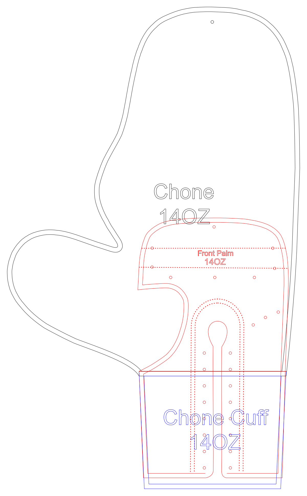

# Shrinking the Front Palm and Thumb to fit the original Chone

2026-11-15

This doc covers the change to the 14 oz lace-up glove pattern that shrinks the Front Palm and the Thumb **together**, so they fit the original (unscaled) Chone and Chone Cuff. It records what we did, why, and the measurements before and after, at three test sizes: 97%, 96% and 95%.

## Contents

- [Summary](#summary)
- [Background: the pieces and how they join](#background-the-pieces-and-how-they-join)
- [What came before this change](#what-came-before-this-change)
- [Why we shrank the Palm and Thumb](#why-we-shrank-the-palm-and-thumb)
- [What 100% means here](#what-100-means-here)
- [Which file we started from](#which-file-we-started-from)
- [What the script does](#what-the-script-does)
- [Results: before and after](#results-before-and-after)
- [Overlays](#overlays)
- [Printing](#printing)
- [A note on the PNG previews](#a-note-on-the-png-previews)
- [Files](#files)
- [How to rebuild](#how-to-rebuild)
- [Open questions](#open-questions)

## Summary

- The Front Palm and the Thumb were scaled to **97%, 96% and 95%** of their current size, each test in its own new file. The Chone, the Chone Cuff and every other piece are untouched.
- Both pieces shrink by the same amount, so the **Thumb seam stays matched** (Thumb 0.6 mm longer than the palm notch, the same as before).
- On the lace side, the palm used to stick out past the Cuff by 0.15–0.24". At **97% it's flush** (within 1 mm). At 96% and 95% it sits slightly inside the back's edge.
- Nothing existing was overwritten. Every output has a new filename, and the new script refuses to write over a file that already exists.

| Test | Lace side vs Cuff | Thumb seam |
| --- | --- | --- |
| 100% (before) | sticks out 4–6 mm | matched (0.6 mm) |
| **97%** | **flush, within 1 mm** | matched (0.6 mm) |
| 96% | 0.5–2.5 mm inside | matched (0.6 mm) |
| 95% | 2–4 mm inside | matched (0.6 mm) |

## Background: the pieces and how they join

The pattern is `dxf/Laces Boxing 14OZ (1).dxf`, in inches. The pieces this change touches:

| Piece | Role |
| --- | --- |
| Front Palm | The palm side of the glove, with the lace slot |
| Thumb | Sewn into the thumb notch on the Front Palm |
| Chone | The main back piece (includes the back of the thumb) |
| Chone Cuff | Sewn to the bottom of the Chone; Chone + Cuff together form the back |

Every piece has an outer (cut) line and an inner line about 0.2" in. Seams are lapped: **one piece's outer line sits on the other piece's inner line.** For the Thumb seam, the Thumb's top-edge **outer** line is sewn onto the Front Palm notch's **inner** line. So to check if two edges fit, we compare outer against inner, measured along the curve (the length a tape measure laid along the line would give).

## What came before this change

Two earlier fixes set up the files this change starts from. They're in [`../PATTERN-NOTES.md`](../PATTERN-NOTES.md); in short:

1. **Front Palm rescale.** In the original drawing the palm notch was 6 mm longer than the Thumb edge sewn to it. This showed up when sewing: the Thumb didn't reach the end of the palm's curve. The palm alone was shrunk so the two edges matched, and saved as `dxf/Laces Boxing 14OZ - palm 96%.dxf`. The Thumb was not changed. After this fix the Thumb was 0.6 mm longer than the notch, which is close enough to sew.
2. **Cuff matched to the Chone.** The Chone Cuff was enlarged slightly (100.58%) so its top outer edge is exactly as long as the Chone's bottom outer edge (6.134"). Saved as `dxf/Laces Boxing 14OZ - palm 96% cuff matched.dxf`. The Palm, Thumb and Chone are identical to file 1.

After those, one problem was still open: the palm was still wider than the back on the lace side. It stuck out past the Cuff's edge by 0.15" at the join, rising to 0.24" at the wrist.

Separately, the Chone has been tested at 105–120% because it's too small to cover the foam. **This change does not use those.** It works against the original Chone.

## Why we shrank the Palm and Thumb

Laid over the original Chone and Cuff, the palm was too big for the back: wider on the lace side, as above.

There were two ways to fix that:

- **Make the back bigger.** That's what the Chone 105–120% tests do, but those change the Chone, and this test is for the original Chone.
- **Make the palm smaller.** This is what we did.

Shrinking only the palm would break the Thumb seam we'd already matched: the notch would get shorter while the Thumb stayed the same. So the **Thumb shrinks by the same amount as the palm**. Both seam edges then get shorter in proportion and stay matched.

The aim was to shrink both by less than 5%. We made three tests, 97%, 96% and 95%, so they can be compared on paper and on the overlay before choosing one.

## What 100% means here

**100% = the Front Palm and Thumb as they are in `palm 96% cuff matched.dxf`**, the latest pattern before this change. The "96%" in that filename refers to the earlier palm fix and doesn't matter here.

So "95%" means both pieces are 95% of their current size, i.e. 5% smaller than now. The same goes for 96% and 97%.

The new files are named `palm+thumb 95%.dxf` and so on. **Don't confuse `palm+thumb 96%.dxf` (this change) with `palm 96%.dxf` (the earlier palm-only fix).** They are different patterns.

## Which file we started from

There are two files with "palm 96%" in the name. We checked them entity by entity:

| Piece | `palm 96%.dxf` vs `palm 96% cuff matched.dxf` |
| --- | --- |
| Front Palm | identical |
| Thumb | identical |
| Chone | identical |
| Chone Cuff | slightly bigger in "cuff matched" (100.58%) |

The earlier true-size print, `print/thumb-and-palm-A4.pdf`, and the piece PNGs were made from `palm 96%.dxf`. Since the Palm and Thumb are identical in both files, those prints still show exactly our 100%.

We started from **`palm 96% cuff matched.dxf`**: it's the latest pattern, it has the original Chone, and its Cuff fits that Chone. That source file was only read, never changed.

## What the script does

`scripts/scale_palm_thumb.py` takes a source DXF, an output DXF and a scale.

1. **Refuses to run** if the output file already exists.
2. Finds the Front Palm: its outer line plus everything whose centre falls inside it (inner line, lace slot, holes, dashed lines, label). That's 480 entities.
3. Finds the Thumb the same way: outer line, inner line, holes, label. That's 17 entities. It checks the two sets don't overlap.
4. Scales the **Palm** about its thumb-notch corner (where the notch meets the straight lower-left side, on the outer line). This is the same pivot as the earlier palm fix, so the palm stays in place on the sheet.
5. Scales the **Thumb** about the centre of its outer line's bounding box, so it also stays in place.
6. Saves the new DXF. Nothing else in the file is moved or changed.

The scaling is uniform: width and height shrink by the same amount, and everything inside the piece moves with it. Holes get slightly smaller too (a 95% hole is 95% of the diameter).

## Results: before and after

All measurements are in inches, from the DXF files.

### Each file was checked

- **Scale:** in every test, the Palm and Thumb came out at exactly the asked-for ratio in both width and height (e.g. 0.950 and 0.950).
- **Nothing else changed:** comparing each new file with the source, the only entities that differ are the 497 Palm and Thumb entities. The Chone (12.200" × 15.372") and Chone Cuff (6.134" × 4.894") are unchanged.

### Sizes

| | 100% (before) | 97% | 96% | 95% |
| --- | --- | --- | --- | --- |
| Front Palm, outer, W × L | 6.47" × 11.16" | 6.28" × 10.82" | 6.21" × 10.71" | 6.15" × 10.60" |
| Thumb, outer, W × H | 6.16" × 3.79" | 5.97" × 3.68" | 5.91" × 3.64" | 5.85" × 3.60" |

### Thumb seam

| | 100% (before) | 97% | 96% | 95% |
| --- | --- | --- | --- | --- |
| Front Palm notch, inner line | 6.258" | 6.070" | 6.008" | 5.945" |
| Thumb top edge, outer line | 6.282" | 6.093" | 6.031" | 5.968" |
| Difference | Thumb +0.6 mm | Thumb +0.6 mm | Thumb +0.6 mm | Thumb +0.6 mm |

The seam is as well matched as before at every size, because both edges shrink together.

### Lace side and wrist

To compare, the palm is laid over the joined Chone + Cuff, the same way as every earlier overlay: not rotated, and its thumb-notch corner pinned to the left end of the Chone/Cuff join. Then we measure how far the palm's right (lace-side) outer edge sits from the Cuff's right outer edge, at three heights:

- **join:** just below the Chone/Cuff seam
- **middle:** halfway down the Cuff
- **wrist:** near the palm's bottom edge

Plus means the palm sticks out past the back. Minus means it sits inside.

| | 100% (before) | 97% | 96% | 95% |
| --- | --- | --- | --- | --- |
| Lace side at join | +0.15" | −0.04" | −0.10" | −0.16" |
| Lace side, middle | +0.19" | 0.00" | −0.06" | −0.12" |
| Lace side at wrist | +0.24" | +0.04" | −0.02" | −0.08" |
| Palm bottom, above the Cuff's bottom | 0.32" | 0.46" | 0.50" | 0.55" |

What this means:

- **97%** puts the lace side flush with the back, within about 1 mm along its whole length.
- **96%** and **95%** go past flush: the palm is 0.5–2.5 mm or 2–4 mm narrower than the back.
- The pinned point is at the top, so a smaller palm also ends higher above the wrist. It gains about 0.05" for every 1% smaller.

## Overlays

Front Palm in red, Chone in black, Chone Cuff in blue.

| 97% | 96% | 95% |
| --- | --- | --- |
|  |  |  |

The Thumb isn't drawn on the overlays. Its fit is checked by the seam lengths above.

## Printing

Each test has a true-size A4 PDF: page 1 is the Front Palm, page 2 the Thumb.

- `print/thumb-and-palm-97-A4.pdf`
- `print/thumb-and-palm-96-A4.pdf`
- `print/thumb-and-palm-95-A4.pdf`

They're made by `scripts/print_pdf.py`, the same as the original `print/thumb-and-palm-A4.pdf`. 1 drawing unit = 1 inch on paper. Each page has check rulers built from real units: 10" up the right margin and 25 cm up the left, plus 6" and 15 cm across on the Thumb page. They don't use the scale bar drawn in the DXF, which is wrong.

**Print at 100% / "Actual size", not "Fit to page".** Measure the rulers before cutting.

## A note on the PNG previews

The piece images in `renders/` (`front-palm.png`, `thumb.png` and the rest) are previews, not true size. `render_pieces.py` makes every image 1200 px wide, whatever the size of the piece, so each image has its own scale: about 172 px per inch for the palm and 180 for the Thumb. Side by side, the Thumb preview looks about 5% too big compared to the palm. **That comes from the images, not the pattern.** Use the PDFs, or the measurements here, to compare sizes.

## Files

All new. Nothing existing was changed, apart from the README tables and `PATTERN-NOTES.md`.

| File | What it is |
| --- | --- |
| `dxf/Laces Boxing 14OZ - palm+thumb 97%.dxf` | Pattern with Front Palm and Thumb at 97% |
| `dxf/Laces Boxing 14OZ - palm+thumb 96%.dxf` | The same at 96% |
| `dxf/Laces Boxing 14OZ - palm+thumb 95%.dxf` | The same at 95% |
| `print/thumb-and-palm-97-A4.pdf` (and `-96`, `-95`) | True-size A4 print of the Palm and Thumb |
| `renders/palm-over-chone-with-cuff-97.png` (and `-96`, `-95`) | The Palm over the original Chone and Cuff |
| `scripts/scale_palm_thumb.py` | Scales the Palm and Thumb together; won't overwrite |

## How to rebuild

From the repo root. Add `uv run --with ezdxf --with matplotlib` in front if the libraries aren't installed. Delete the old outputs first, because the scale script won't overwrite them.

```sh
for p in 97 96 95; do
  python scripts/scale_palm_thumb.py "dxf/Laces Boxing 14OZ - palm 96% cuff matched.dxf" "dxf/Laces Boxing 14OZ - palm+thumb $p%.dxf" 0.$p
  python scripts/print_pdf.py "dxf/Laces Boxing 14OZ - palm+thumb $p%.dxf" print/thumb-and-palm-$p-A4.pdf
  python scripts/overlay_palm.py "dxf/Laces Boxing 14OZ - palm+thumb $p%.dxf" renders/palm-over-chone-with-cuff-$p.png
done
```

`overlay_palm.py` is run with no scale argument, because the palm in these files is already scaled.

## Open questions

- [ ] **Pick one size.** Print the three PDFs, cut test pieces and choose. On the numbers, 97% gives a flush lace side; 96% and 95% leave the palm slightly narrower than the back.
- [ ] **Thumb against the Chone.** The Thumb's lower edge is sewn to the Chone's thumb, which wasn't scaled. Check that seam at the chosen size.
- [ ] **Thumb Panel and linings.** The Thumb Panel strip, the Front Palm Inside Lining and the thumb inside lining weren't scaled. Check them against the chosen size.
- [ ] **Wrist edge.** A smaller palm ends higher above the Cuff's bottom edge (0.46–0.55" instead of 0.32"). Check that's fine for the cuff and lacing.
- [ ] **Foam.** A smaller palm and Thumb make the glove smaller overall. The earlier notes found the original Chone too small to cover the foam, so check the foam fits too.
